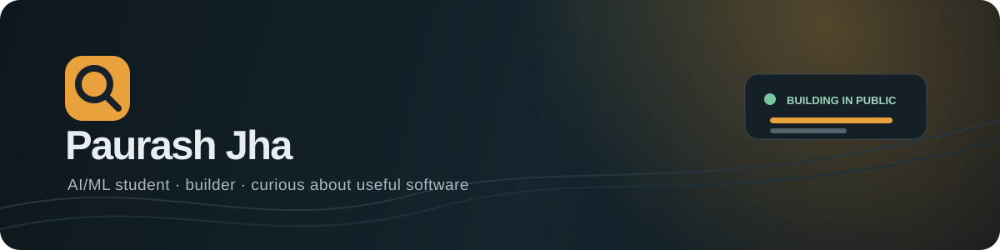

## Hi, I'm Paurash.

**BE CSE (AI/ML) student at Chandigarh University** building practical software that turns messy problems into clear, useful experiences.

I like working at the intersection of **AI/ML, automation, developer tools, and thoughtful product design** — especially when the result is something people can actually use.

> Building in public, learning by shipping, and making complex things feel simple.

## What I'm exploring

- **AI/ML engineering** — turning models and data into useful workflows
- **Developer tools** — CLI utilities, automation, and reproducible builds
- **Privacy-first products** — transparent interfaces and user-controlled analysis
- **Human-centered systems** — dashboards, decision tools, and explainable outputs

## Featured work

### [DarkLens](https://github.com/Paurash324/Darklens)
A privacy-conscious Chrome extension that surfaces potential dark patterns with local, evidence-first rules.

`TypeScript` `React` `Chrome MV3` `Privacy`

### [survey2report](https://github.com/Paurash324/survey2report)
A CLI tool that turns messy survey CSVs into polished PowerPoint reports.

`Python` `CLI` `Data workflows` `Automation`

### [Energy Leak Finder](https://github.com/Paurash324/zinnovation-energy-leak-finder)
A lightweight web experience for spotting everyday energy-loss opportunities.

`JavaScript` `Sustainability` `Web app`

### [Digital Adoption Readiness Tool](https://github.com/Paurash324/digital-adoption-readiness-tool)
An interactive tool for thinking through digital transformation readiness.

`TypeScript` `React` `Assessment tool`

## My toolkit

## Currently

- Sharpening my foundations in **machine learning and applied AI**.
- Building small products that combine **useful automation with clear UX**.
- Improving my engineering habits: **tests, documentation, accessibility, and deployment**.
- Open to thoughtful collaborations, student projects, and ideas worth shipping.

## GitHub snapshot

## Let's connect

If you're building something useful, exploring AI/ML, or thinking about a student collaboration, feel free to open an issue or start a conversation through GitHub.

**Explore the repositories → [github.com/Paurash324](https://github.com/Paurash324?tab=repositories)**

